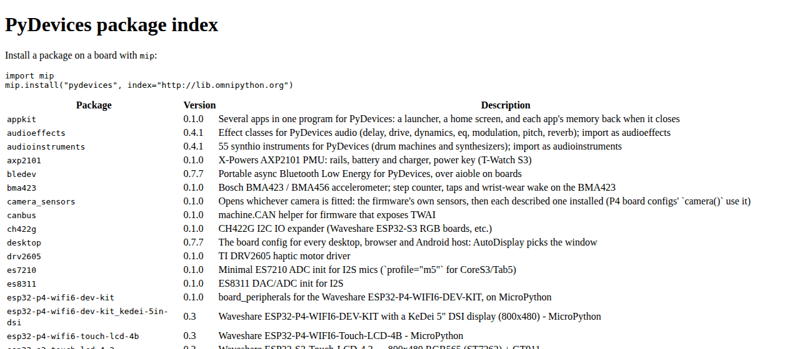

# lib

The `mip` index for OmniPython's libraries, board configs and drivers, at **https://pydevices.github.io/lib**.

## Install

On a board with Wi-Fi, in the REPL:

```python
import mip
mip.install("pydevices", index="https://pydevices.github.io/lib")
```

From a computer, onto a board on USB:

```bash
mpremote mip install --index https://pydevices.github.io/lib pydevices
```

## Try it

With the unix port of MicroPython, install pygraphics into `lib/` and draw:

```bash
micropython -m mip install --index https://pydevices.github.io/lib --target lib pygraphics
```

```python
import pygraphics
from pygraphics import FrameBuffer, RGB565

fb = FrameBuffer(bytearray(160 * 80 * 2), 160, 80, RGB565)
fb.fill(0x0000)
card = fb.round_rect(8, 8, 64, 40, 8, 0xF800, f=True)
dot = fb.circle(116, 28, 20, 0x07E0, f=True)
label = pygraphics.text16(fb, "Hello", 8, 56, 0xFFFF)
print("changed:", card + dot + label)
fb.save("hello.bmp")
```

```text
changed: Area(8, 8, 128, 64)
```


[Docs](https://github.com/PyDevices/lib/blob/main/docs/index.md) · [Examples](https://pydevices.github.io/gallery/gallery/) · [Roadmap](ROADMAP.md)

Made by [PyDevices](https://pydevices.com).
